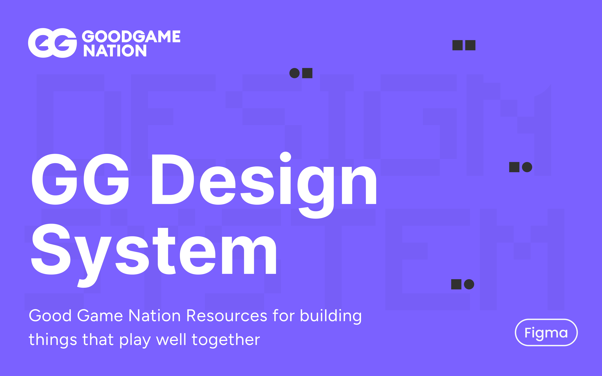

<p align="center">
  
</p>

<h1 align="center">Good Game Design System</h1>

<p align="center">
  Official React component library and design tokens for building Good Game products.
</p>

<p align="center">
  <a href="https://www.npmjs.com/package/@goodgame/core"></a>
  <a href="https://bundlephobia.com/package/@goodgame/core"></a>
  <a href="https://github.com/kartikpd19/GG-Design-System/stargazers"></a>
</p>

<p align="center">
  <a href="https://kartikpd19.github.io/GG-Design-System/">Documentation</a>
  •
  <a href="https://kartikpd19.github.io/GG-Design-System/?path=/docs/catalog--docs">Catalog</a>
  •
  <a href="https://kartikpd19.github.io/GG-Design-System/?path=/docs/playground--docs">Playground</a>
</p>

## Overview

Good Game is a design system built from the **GG Design System** Figma file. It gives you:

- **React components** whose props match the Figma variant properties one-to-one.
- **Design tokens** as CSS custom properties for color, typography, spacing and radius.
- **Accessible defaults**: correct roles, keyboard support and a visible focus ring on every interactive component.
- **Storybook docs** for every component, with a props table, variants, do's and don'ts, and accessibility notes.

## Installation

```bash
npm install @goodgame/core
```

Then import the tokens once in your app's root file:

```ts
import "@goodgame/core/tokens";
```

Typography uses **Inter**. Load it from Google Fonts or self-host it.

## Usage

```tsx
import { Button } from "@goodgame/core";

export function Example() {
  return <Button>Save</Button>;
}
```

## Ecosystem

| Package                             | Description                                  |
| ----------------------------------- | -------------------------------------------- |
| [`@goodgame/core`](packages/core)   | React components                             |
| [`@goodgame/style`](packages/style) | Design tokens as CSS custom properties       |
| [`@goodgame/icons`](packages/icons) | SVG icons as React components (coming soon)  |
| [`@goodgame/docs`](packages/docs)   | Storybook documentation site (not published) |

## Contributing

Contributions are welcome. Read [CONTRIBUTING.md](CONTRIBUTING.md) for setup, conventions and the PR checklist.

### Repository structure

```
.github/          CI, Storybook deploy and release workflows, issue/PR templates
.cursor/rules/    conventions for AI coding tools
packages/
  core/           @goodgame/core   React components
  style/          @goodgame/style  design tokens
  icons/          @goodgame/icons  icons
  docs/           Storybook app (Introduction, Getting Started, Foundations, Catalog, Playground)
scripts/          Figma variables → token sync
```

## Suggestions

Have an idea or a question? Start a thread in [GitHub Discussions](https://github.com/kartikpd19/GG-Design-System/discussions). Found a bug? [Open an issue](https://github.com/kartikpd19/GG-Design-System/issues/new/choose).

## License

[MIT](LICENSE)
